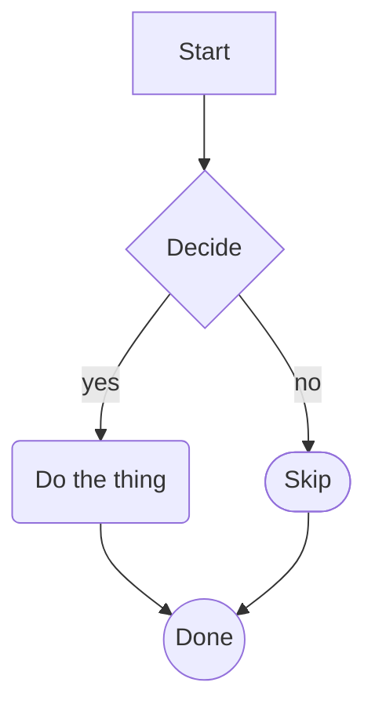

# MarkDownIt

A native Windows Markdown viewer. MarkDownIt is a single executable with no
Electron shell, no .NET runtime, and no bundled dependencies. It opens Markdown
files and renders them with Direct2D and DirectWrite.

## Build

MarkDownIt needs CMake 3.20 or later, Visual Studio 2022 Build Tools, and the
Windows 10 SDK.

```powershell
cmake -S . -B build -G "Visual Studio 17 2022" -A x64
cmake --build build --config Release
```

The executable is written to `build/Release/MarkDownIt.exe`.

## Use

Open a file from Explorer, drag a Markdown file onto the window, or use **Open**
in the ribbon. The editor can switch between rendered Markdown and source view.

### Zoom

Zoom is a global view setting, not per-document state. The factor you set carries
over when you open another file, and the last factor used is restored on the next
launch. Supported range is 25% to 400%. Zoom applies to document content only;
the ribbon and scrollbar keep their size.

## Mermaid diagrams

MarkDownIt renders `mermaid` fenced blocks locally with Direct2D and DirectWrite.
It does not start a browser, run JavaScript, or use the network. Flowchart labels
use DirectWrite metrics, and the renderer caches flowchart layouts by fence source
and zoom.

Supported diagram types:

- Flowcharts.
- Pie charts.
- Sequence diagrams.

Flowcharts support:

- Headers: `flowchart` or `graph` with TD/TB, BT, LR, or RL direction.
- Node shapes: rectangle `A[text]`, rounded `A(text)`, stadium `A([text])`,
  diamond `A{text}`, and circle `A((text))`.
- Edges: solid `-->`, dotted `-.->`, thick `==>`, plain lines without arrows,
  and labels such as `A -->|label| B`.
- Chains such as `A --> B --> C`.
- Reusing a node id in a later statement.
- Simple subgraphs, rendered as flat lane bands.

Example:

````

````

### Limits

- Flowchart subgraphs are flat. Nested bands, per-subgraph direction, and routing
  around band borders are not implemented.
- Mermaid styling directives, click handlers, and classes are not implemented.
- Class and state diagrams have parser and layout code, but they are not connected
  to `mermaid` fences in the application.
- Browser Mermaid and the native renderer do not use the same font engine. The
  native layout follows dagre's topology and default spacing, but browser pixels
  are not a rendering target.

See [references/mermaid-dagre-port.md](references/mermaid-dagre-port.md) for the
layout pipeline and golden-oracle test setup.

## Mermaid Diagram Support

MarkDownIt renders fenced code blocks with the `mermaid` language tag as
diagrams instead of raw text.

### Supported

- **flowchart** and **graph** with directions TD, TB, LR, RL, BT
- **sequenceDiagram** with participants and messages

Node shapes: rectangle `[]`, rounded `()`, diamond `{}`, circle `(())`,
stadium `([])`.

Edge styles: solid `-->`, dotted `-.->`, thick `==>`, with labels
`-->|text|`.

### Not Supported

Unsupported diagram types fall back to plain code block rendering:

- gantt, class, state, ER, pie, journey, C4, mindmap
- subgraph blocks
- style/class directives (e.g. `style A fill:#f9f`)
- clickable links in diagrams
- Diagram themes

### Edit Mode

In edit mode, the diagram source is shown as plain text when the caret
is inside the block, so you can edit the diagram. The rendered diagram
reappears when the caret moves outside the block.

## License

MIT. See [LICENSE](LICENSE).
