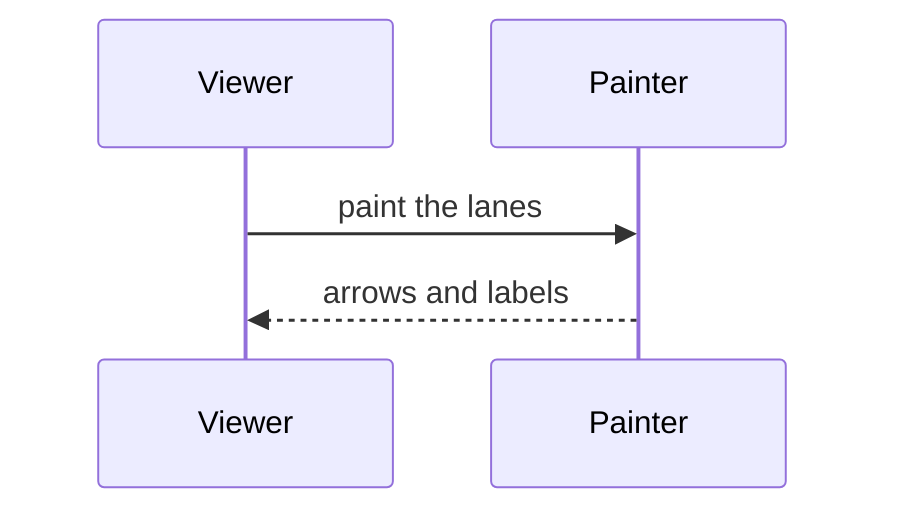
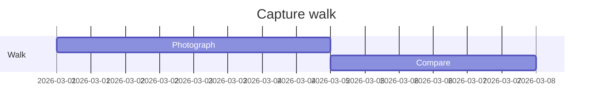
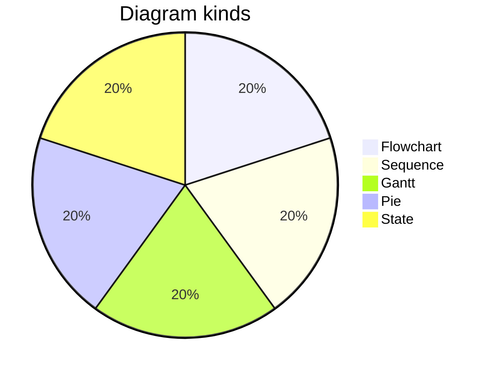
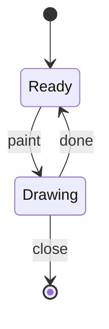

# MarkDownIt diagram showcase

Every diagram kind the renderer paints has a section here. The capture
walk photographs one section at a time, so a kind whose painter went
missing leaves a visibly empty frame in the parity comparison.

## Sequence diagram

## Gantt chart

## Pie chart

## State diagram

## Notes

The four sections above share one fixture so the capture walk can open
it, scroll to a heading and photograph exactly one diagram kind per
state. The flowchart already has a home in the layout showcase, whose
diagram section the end state frames, so it is not repeated here.

Keeping the diagrams out of the layout showcase also keeps the stored
layout dump goldens out of the change. That dump reads only the files
under tests/fixtures/parity, and the walk reads this file instead.

A state that framed the wrong heading would show a neighbouring
diagram, which the side by side picture makes obvious. A state whose
diagram did not paint at all shows the heading and the empty space
below it, which the ink and row checks treat as a failure.

The trailing notes give the last section room to scroll its heading to
the top of the pane, so the four frames are anchored the same way
rather than clamped against the foot of a short page.

The same text runs on both platforms. Windows and macOS photograph
the same states by name, and the comparison tool pairs them, so a
difference in the drawing is a red job rather than a note in a log.
