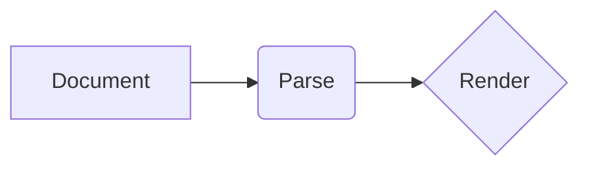

# MarkDownIt layout showcase

One document with every element the renderer draws.

The launch smoke photographs its states on the CI runner.

The paragraph carries **bold**, *italic*, `inline code`, a
[link](https://example.com), and ~~struck text~~.

## Lists and tasks

- A bullet, plain
- A bullet with **bold** inside
  - Nested one level, for the indent

1. First numbered item
2. Second numbered item
3. Third numbered item

- [x] A finished task
- [ ] An open task

## Information boxes

> Info: A neutral hint that adds context.

> Warning: Something needs care before you go on.

> Danger: This step cannot be undone.

> Success: The change is live.

## A quote

> Quoted text keeps the bar and reads muted, one restrained cue.

### A table

| Column | Meaning | Number |
|--------|---------|--------|
| First  | A short cell | 1 |
| Second | A longer cell, to give the column something to hold | 22 |
| Third  | Another | 333 |

#### Code

```cpp
// A fenced block in the monospaced face.
int main() {
    return 0;
}
```

##### A small heading

Body text below the smaller headings keeps the rhythm.

###### The smallest heading

It reads muted, the quietest step of the scale.

---

## A diagram



## Deep nesting

- Level one, for the indent
  - Level two, one step in
    - Level three, where a wrapped line like this one keeps every word aligned with the bullets above

## Long tokens and a wide table

[A long link](https://example.com/a/deep/path/that/keeps/client-identifiers-intact) and `an_inline_code_span_that_cannot_break_easily` share one line.

| Step | Owner | Input | Output | Notes | Status |
|------|-------|-------|--------|-------|--------|
| Parse | The parser | Source | A tree | Styles kept | Done |
| Lay out | The renderer | The tree | Lines | Cache reused | Done |

## Long code lines

```cpp
// A comment far longer than the reading column, to show a code block keeping its indentation and never forcing the page wider.
int result = compute(with_a, very_long_argument_list, that_keeps, going_and, going);
```
